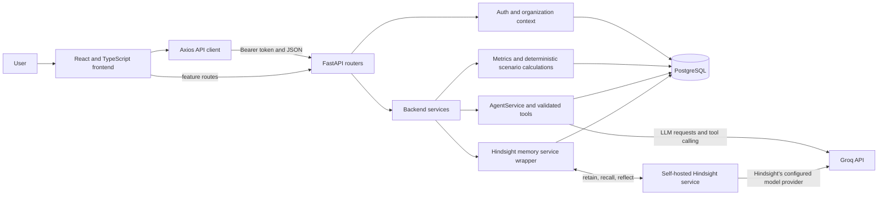
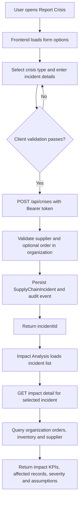
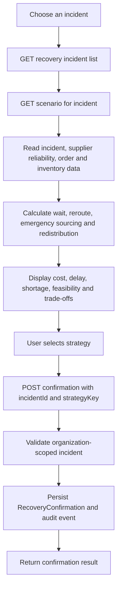
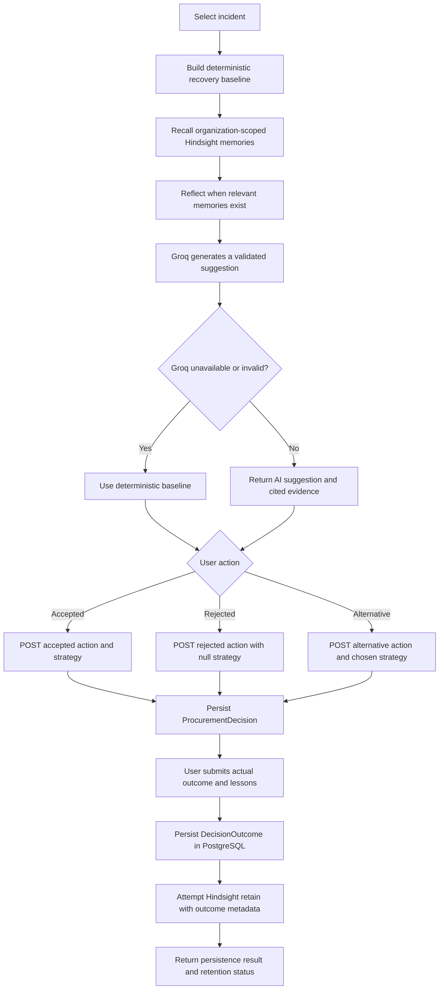
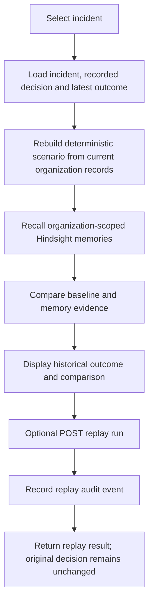
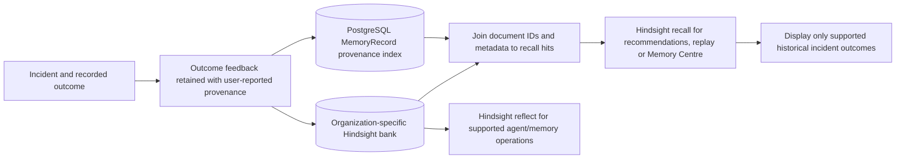
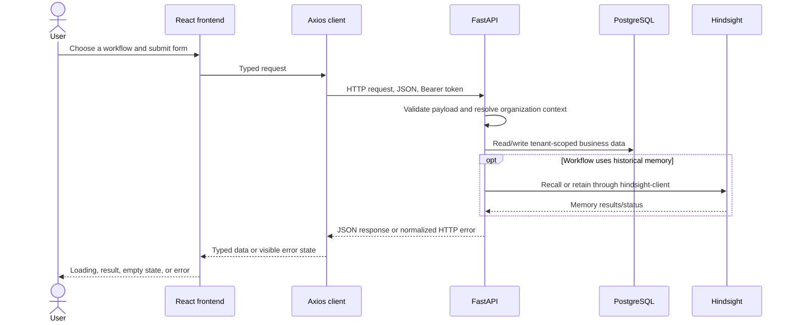
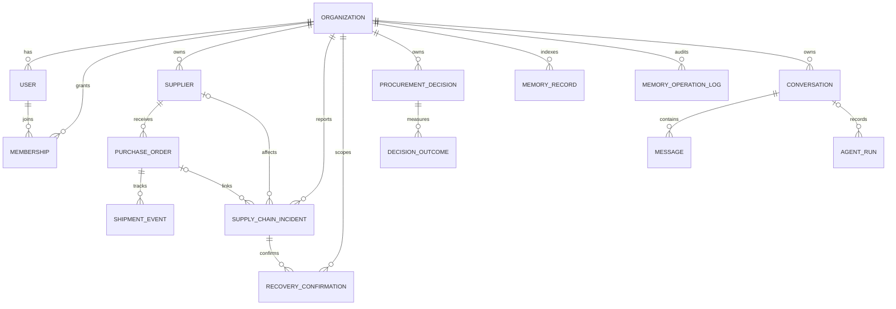

# Resilient Supply Chains

**Resilient Supply Chains** (the backend's application name is **SUPPLYMIND**) is a supply-chain operations and decision-support application. It helps procurement and operations teams see disruption risk, record incidents, compare recovery options, and reuse verified experience from prior supplier and logistics outcomes.

> **Project status:** The React frontend and FastAPI backend are integrated on `master`. Operational estimates are decision support, not automated execution or guaranteed forecasts. The AI chat API is implemented in the backend, but there is currently no AI-agent page in the frontend.

## Contents

- [Project at a glance](#project-at-a-glance)
- [Technology stack](#technology-stack)
- [Architecture](#architecture)
- [Features](#features)
- [Process flows](#process-flows)
- [API reference](#api-reference)
- [Data and memory architecture](#data-and-memory-architecture)
- [Installation and setup](#installation-and-setup)
- [Testing and verification](#testing-and-verification)
- [Live demonstration guide](#live-demonstration-guide)
- [Repository structure](#repository-structure)
- [Limitations and future improvements](#limitations-and-future-improvements)

## Project at a glance

Supply chains can be disrupted by late shipments, supplier failures, shortages, and changing transportation conditions. Teams often have to make decisions using fragmented order information and lessons that are difficult to find after an incident has passed.

This application brings together organization-scoped supplier, order, inventory, and incident records. It provides dashboards and impact views, deterministic recovery scenarios, decision capture, and a connection to **Hindsight**, a separate persistent memory service. Memory allows relevant retained outcomes to be recalled for later decisions rather than treating every incident as entirely new.

### Who it is for

- Procurement teams comparing suppliers and recording sourcing decisions.
- Supply-chain and operations teams coordinating incident response.
- Managers reviewing exposure, recovery options, and decision outcomes.
- Evaluators exploring a synthetic demonstration dataset and memory-informed workflows.

### Practical capabilities

- Monitor order, supplier, and bottleneck indicators.
- Report shipment disruptions, supplier failures, and inventory shortages.
- Assess linked orders and inventory using records in the active organization.
- Compare four recovery strategies: wait, reroute, emergency sourcing, and redistribution.
- Record a human-selected decision and its measured outcome.
- Retain suitable outcomes in Hindsight and retrieve relevant experiences later.
- Replay a decision analytically without changing the historical decision.

**AI and analytics have distinct roles.** Impact analysis and recovery scenarios use deterministic calculations over PostgreSQL records. The Decision Report combines that scenario baseline with a structured Groq recommendation. Before generation, the backend recalls from the authenticated organization's Hindsight bank and reflects only when relevant memories are available. Invalid or unavailable AI output falls back to the deterministic scenario. The separate `/api/v1/agent/*` chat API also uses Groq tool calling, but has no frontend page.

## Technology stack

| Area | Technology | Use in this project |
|---|---|---|
| Frontend | React 19, TypeScript, React Router | Component-based UI, typed API models, and page navigation. |
| Styling and icons | Tailwind CSS 4, `@tailwindcss/vite`, Lucide React | Utility-based styling and interface icons. |
| Charts | Recharts | Dashboard and data visualizations. |
| HTTP | Axios | API requests, timeout/error normalization, and Bearer-token attachment. |
| Frontend tooling | Vite 8, TypeScript compiler, Oxlint | Development server/proxy, production build, type-checking, and linting. |
| Backend | Python 3.11+, FastAPI, Pydantic | REST API, validation, serialization, and interactive OpenAPI documentation. |
| Persistence | PostgreSQL, SQLAlchemy 2, psycopg | Relational business data and JSONB-backed evidence/details. |
| Schema changes | Alembic | Versioned database migrations. |
| Authentication | PyJWT, Argon2 | Signed bearer access tokens and password hashing. |
| AI assistant | Groq Python SDK | LLM requests and tool calling in the backend agent. |
| Organizational memory | `hindsight-client` and a self-hosted Hindsight server | Retain, recall, and reflect on experiences in an organization-specific memory bank. |
| Background work | APScheduler | Optional periodic monitoring of scheduled actions and orders. |
| Backend testing | pytest, pytest-asyncio | Backend test suite and asynchronous test support. |
| Local helper | PowerShell | Windows Hindsight startup helper; PostgreSQL itself is installed and managed separately. |

No frontend AI-agent screen, container orchestration configuration, or production deployment manifest is currently included.

## Architecture

The browser uses React pages and an Axios client to call FastAPI. The API resolves the Bearer token to a user and organization for protected routes. Business records and audit/provenance metadata are stored in PostgreSQL. The Hindsight client connects to a separately running Hindsight service; the AI agent can additionally call Groq and validated backend tools.



In development, Vite proxies `/api` to the backend (by default `http://127.0.0.1:8000`). Feature workflows use JSON `{ "data": ... }` responses. Authentication and the dashboard have their own response shapes.

## Features

| Feature | What it does and how to use it | Frontend | Backend |
|---|---|---|---|
| Authentication | In API mode, the shared client obtains a demo access token through demo login and attaches it as a Bearer token. The backend also has account registration, password login, and current-user routes. | Shared API and auth services; the current UI uses demo login rather than a dedicated login screen. | `/api/v1/auth/*`; `User`, `Organization`, `Membership`, audit logs, JWT security helpers. |
| Dashboard | Presents operational KPIs, supplier reliability, order trends, and upcoming deliveries from the dashboard API. | `DashboardPage` and `components/dashboard/`. | `GET /api/v1/dashboard`; metrics service reads organization-scoped PostgreSQL records. |
| Crisis and incident reporting | Loads form options, validates crisis-specific fields, checks supplier/order association, and persists the incident. Shipment disruptions require shipment, origin, destination, and delay; shortages require available inventory. | `ReportCrisisPage`, `useCrisisReportForm`, and `components/report-crisis/`. | `/api/crises/form-options`, `POST /api/crises`; `SupplyChainIncident`, `Supplier`, and optional `PurchaseOrder`. |
| Impact analysis | Selects a reported incident and calculates exposure using linked open orders and matching inventory. Severity follows the incident urgency. | `ImpactAnalysisPage` and `components/impact-analysis/`. | `/api/impacts/incidents*`; deterministic query/calculation in the impact router using `PurchaseOrder`, `InventoryItem`, and `Supplier`. |
| Recovery simulations | Builds the four supported scenarios from incident delay, recorded order financial impact, supplier reliability, and inventory/reorder-point values. The user chooses and confirms a strategy; confirmation is persisted. | `RecoverySimulatorPage`, `useRecoverySimulator`, and `components/recovery-simulator/`. | `/api/recovery-simulations/*`; `build_scenario`, metrics service, and `RecoveryConfirmation`. |
| Decision recommendations and actions | Displays a Groq-generated suggestion grounded in current incident/scenario data and organization-scoped Hindsight evidence, or the deterministic baseline if generation fails. The user can accept, reject, or record an alternative. A rejected action sends a null strategy key. | `DecisionReportPage`, `useDecisionReport`, and `components/decision-report/`. | `/api/decisions/*`; `build_scenario`, Hindsight recall/reflect, `AgentService`, `ProcurementDecision`, and audit logs. |
| Outcome feedback | Saves actual cost, delay, shortage, affected-order count, success, and lessons. The business outcome is committed to PostgreSQL before Hindsight retention is attempted. | `OutcomeFeedbackForm` within the Decision Report page. | `POST /api/decisions/outcomes`; `DecisionOutcome.details`, `MemoryRecord` provenance, memory operation logs, and the Hindsight bank. |
| Decision replay | Reconstructs an incident's recorded decision and outcome, compares the current deterministic baseline with organization-scoped Hindsight evidence, and explains the comparison. Running a replay does not execute a recovery or alter the original decision. | `DecisionReplay` page and `pages/DecisionReplay/components/`. | `/api/decision-replays/*`; `ProcurementDecision`, `DecisionOutcome`, `build_scenario`, memory recall, and audit log. |
| Memory Centre | Recalls outcome memories, shows overview and searchable historical records, and opens an individual result. Search supports crisis type, supplier, outcome, and date range. | `MemoryCentrePage`, `useMemoryCentre`, and `components/memory-centre/`. | `/api/memories*`; Hindsight recall plus the organization-scoped `MemoryRecord` provenance index. |
| AI procurement agent | Backend chat uses Groq tool calling, validated PostgreSQL tools, and optional Hindsight recall/reflect. Conversation and run traces are persisted. **There is no corresponding frontend page in `App.tsx`; use the API directly.** | Not implemented in the current frontend routes. | `/api/v1/agent/*`; `AgentService`, `services/tools.py`, `Conversation`, `Message`, `AgentRun`, and Hindsight. |

### Important interpretation of estimates

- Impact financial exposure sums `financial_impact` on matching open purchase orders; it is not a revenue forecast.
- Customer labels use order destinations because the current order model does not include a separate customer entity.
- Warehouse location and coverage-day values are not inferred when source fields are absent.
- Recovery calculations are deterministic scenario comparisons, not live routing, inventory transfer, supplier purchase, or shipment execution.
- Decision recommendations are AI-generated suggestions constrained to the deterministic scenario's supported strategies. Cost, delay, and shortage estimates are taken from the selected scenario; AI output is not an autonomous optimizer or an operational action.

## Process flows

### A. Crisis reporting and impact analysis



### B. Recovery simulation and strategy confirmation



### C. Decision recommendation, action, and outcome



### D. Decision replay



### E. Historical memory lifecycle



### F. Application request and response



## API reference

FastAPI's interactive documentation is available at:

- Swagger UI: `http://127.0.0.1:8000/docs`
- ReDoc: `http://127.0.0.1:8000/redoc`
- OpenAPI JSON: `http://127.0.0.1:8000/openapi.json`

Unless stated otherwise, feature endpoints require `Authorization: Bearer <access-token>`. The demo frontend obtains a token from demo login in API mode. Core feature endpoints return `{ "data": ... }`; not every older API uses that envelope. The dashboard returns its object at the JSON root, while auth responses include `access_token`, `user`, and `organization`. FastAPI validation errors use HTTP 422; missing/invalid tokens use 401.

### Authentication and operations (`/api/v1`)

| Method and path | Auth | Purpose, important inputs, and response |
|---|---|---|
| `POST /api/v1/auth/register` | Public | Create an account and organization; body includes `email`, `password`, `full_name`, and `organization_name`. Returns token, user, and organization. |
| `POST /api/v1/auth/login` | Public | Authenticate with `email` and `password`; returns token, user, and organization. |
| `POST /api/v1/auth/demo-login` | Public | Bootstrap/sign into the labeled synthetic demo organization; no body; returns token, user, and organization. |
| `GET /api/v1/auth/me` | Bearer | Return current user and organization. |
| `GET /api/v1/dashboard` | Bearer | Organization dashboard object; **raw response, not `{data: ...}`**. |
| `GET /api/v1/bottlenecks?severity=...` | Bearer | Deterministic bottleneck list; optional severity filter; returns `count`, `items`, and demo-data note. |
| `GET /api/v1/health` | Public | Dependency status for PostgreSQL and Hindsight, plus integration flags. |
| `GET /api/v1/settings` | Bearer | Runtime organization, user, model, integration, and scheduler settings. |

### Crisis reporting and impact (`/api`)

| Method and path | Auth | Purpose, important inputs, and response |
|---|---|---|
| `GET /api/crises/form-options` | Bearer | Crisis type, urgency, and organization supplier options in `data`. |
| `POST /api/crises` | Bearer | Create an incident and return `data.incidentId`, `demo`, and message. |
| `GET /api/impacts/incidents` | Bearer | List the current organization's incidents. |
| `GET /api/impacts/incidents/{incidentId}` | Bearer | Return incident, KPIs, affected products, warehouse/order impact, distribution, severity, and assumptions. |

The crisis request uses camelCase fields: `crisisType`, `incidentTitle`, `description`, `supplierId`, `shipmentId`, `productComponent`, `origin`, `destination`, `expectedDelayDays`, `availableInventoryQuantity`, `affectedOrders`, `urgency`, and `incidentDate`. Nullable fields should be sent as `null` where not applicable. `Shipment Disruption` requires shipment/order ID, origin, destination, and delay. `Shipment Disruption` and `Supplier Failure` require delay; `Inventory Shortage` requires available quantity. A linked shipment may be identified by purchase-order UUID or order number and must belong to the same organization and supplier.

### Recovery simulations (`/api`)

| Method and path | Auth | Purpose, important inputs, and response |
|---|---|---|
| `GET /api/recovery-simulations/incidents` | Bearer | List incidents available for simulation. |
| `GET /api/recovery-simulations/incidents/{incidentId}` | Bearer | Return scenario constraints, four strategy estimates, recommendation, and explanation. |
| `POST /api/recovery-simulations/confirmations` | Bearer | Body: `{ "incidentId": "...", "strategyKey": "wait" }`; records a strategy confirmation and returns its ID and message. |

Valid `strategyKey` values are `wait`, `reroute`, `emergency-sourcing`, and `redistribute`. Confirmation records the user's selection; it does not dispatch shipments or place orders.

### Decision management (`/api`)

| Method and path | Auth | Purpose, important inputs, and response |
|---|---|---|
| `GET /api/decisions/incidents` | Bearer | List incidents for decision review. |
| `GET /api/decisions/incidents/{incidentId}/recommendation` | Bearer | Build a deterministic baseline, recall and optionally reflect on the current organization's memories, then return a validated Groq suggestion or baseline fallback, alternatives, cited historical evidence, and memory/reflection status. |
| `POST /api/decisions/actions` | Bearer | Record an `accepted`, `rejected`, or `alternative` action; fields: `incidentId`, `action`, nullable `strategyKey`, and `explanation`. Returns confirmation ID/message. |
| `POST /api/decisions/outcomes` | Bearer | Record actual cost, delay, shortage, affected orders, success, lessons, and notes. Returns outcome ID/message and whether Hindsight retention was available. |

Action requests must use `strategyKey: null` for a rejection; accepted and alternative actions require a strategy key. Outcome fields are `incidentId`, `strategyKey`, `actualAdditionalCost`, `actualDeliveryDelayDays`, `actualInventoryShortage`, `ordersAffected`, `successful`, `lessonsLearned`, and `additionalNotes`. Database persistence of outcome feedback is independent of Hindsight availability.

### Decision replay (`/api`)

| Method and path | Auth | Purpose, important inputs, and response |
|---|---|---|
| `GET /api/decision-replays/incidents` | Bearer | List replayable incidents. |
| `GET /api/decision-replays/{incidentId}` | Bearer | Return original decision/outcome when present, current scenario, memory-free and memory-informed comparison, and historical evidence. |
| `POST /api/decision-replays/{incidentId}/run` | Bearer | Run analytical comparison; no body; returns incident ID, replay status, and message. The original decision is unchanged. |

### Memory Centre (`/api`)

| Method and path | Auth | Purpose, important inputs, and response |
|---|---|---|
| `GET /api/memories/overview` | Bearer | Recall matching organization memories and return stats, memories, lifecycle descriptions, and filter options. |
| `GET /api/memories?crisisType=...&supplier=...&outcome=...&dateFrom=...&dateTo=...` | Bearer | Search Hindsight recall results; supported outcome values are `Successful` and `Ineffective`. |
| `GET /api/memories/{memoryId}` | Bearer | Retrieve a recalled item by its local provenance ID. |

The Memory Centre only presents records whose metadata includes a recognized crisis type and a success value. The search is retrieval-based, does not paginate, and only filters the recalled result set; it is not a full-text database export.

### Existing supplier, order, alert, simulation, and memory APIs (`/api/v1`)

These are also implemented, organization-scoped APIs. They return their resource JSON/count objects rather than a universal `{data: ...}` envelope.

| Methods and paths | Auth | Purpose and key request data |
|---|---|---|
| `GET/POST /api/v1/suppliers`; `GET/PATCH /api/v1/suppliers/{supplier_id}` | Bearer | List, create, retrieve, and update suppliers. Create uses supplier profile fields such as name, categories, contact, lead days, and notes. Responses include reliability metrics where available. |
| `GET/POST /api/v1/orders`; `GET/PATCH /api/v1/orders/{order_id}` | Bearer | Filter/list, create, retrieve, or update purchase orders. Create includes `supplier_id`, `product`, `quantity`, `promised_date`, and optional status, priority, destination, transport, tracking, and impact fields. |
| `GET /api/v1/orders/{order_id}/events`; `POST /api/v1/orders/{order_id}/events` | Bearer | List or append shipment events for an order; event body includes type, date, location, and description. |
| `GET /api/v1/shipments` | Bearer | List shipment/order tracking data. |
| `GET /api/v1/alerts?status=...&limit=...`; `PATCH /api/v1/alerts/{alert_id}` | Bearer | List and update alert status. |
| `GET /api/v1/alerts/scheduled-actions?status=...` | Bearer | List organization scheduled actions. |
| `POST /api/v1/what-if` | Bearer | Run a deterministic supplier disruption scenario; includes supplier, disruption duration, and optional question; response includes historical-memory context where available. |
| `POST /api/v1/suppliers/compare` | Bearer | Compare supplier names with optional requirements. |
| `POST /api/v1/agent/chat` | Bearer | Run an agent conversation; body supports `message`, optional `conversation_id`, `memory_enabled`, and `new_conversation`. Returns the agent run/answer and evidence. Requires configured Groq for model responses. |
| `GET /api/v1/agent/runs?limit=...`; `GET /api/v1/agent/runs/{run_id}` | Bearer | List or retrieve persisted agent run details. |
| `GET /api/v1/agent/conversations?limit=...`; `GET /api/v1/agent/conversations/{conversation_id}` | Bearer | List conversations or retrieve conversation messages. |
| `GET /api/v1/memory/overview`; `GET /api/v1/memory/records?limit=...`; `GET /api/v1/memory/history?limit=...` | Bearer | Inspect Hindsight operation metrics, local provenance records, and operation history. |
| `POST /api/v1/memory/retain` | Bearer | Retain a memory with content, category, source type, optional supplier/order references, event date, and confidence. Verified business facts must reference an in-organization supplier or order. |
| `POST /api/v1/memory/recall`; `POST /api/v1/memory/reflect` | Bearer | Query Hindsight; recall takes query/types/token budget, reflect takes query/context/budget. |
| `POST /api/v1/memory/reset?confirm=true` | Bearer; demo org only | Reset the demo memory bank. This destructive endpoint is restricted to the demo organization and requires explicit confirmation. |
| `GET /api/v1/lab/rubric`; `GET /api/v1/lab/experiments`; `GET /api/v1/lab/summary?experiment_id=...` | Rubric is public; others Bearer | Inspect the Memory Learning Lab rubric, experiments, and summary. |
| `POST /api/v1/lab/experiment/new`; `POST /api/v1/lab/stage` | Bearer | Start a lab experiment or run a validated experiment stage. |

Consult `/docs` for complete Pydantic request/response schemas and generated examples.

## Data and memory architecture

### PostgreSQL models

SQLAlchemy models are declared in [`backend/app/models.py`](backend/app/models.py). The core model groups are:

- **Tenancy and identity:** `Organization`, `User`, `Membership`, `AuditLog`.
- **Supply operations:** `Supplier`, `PurchaseOrder`, `ShipmentEvent`, `SupplierComplaint`, `QualityIncident`, `InventoryItem`, `InventoryMovement`, `Alert`, and `ScheduledAction`.
- **Incident decision workflows:** `SupplyChainIncident`, `RecoveryConfirmation`, `ProcurementDecision`, and `DecisionOutcome`.
- **Agent and evaluation:** `Conversation`, `Message`, `AgentRun`, `EvaluationRun`, and `EvaluationResult`.
- **Memory provenance:** `MemoryRecord` and `MemoryOperationLog`.

Most business rows include `organization_id`. Protected API requests derive organization context from the token; feature list/detail queries filter by that organization, and crisis creation validates supplier/order ownership before linking them.



`DecisionOutcome` references its `ProcurementDecision`. The incident association for a procurement decision is currently stored in the decision's JSON `evidence` rather than a relational incident foreign key. `MemoryRecord` is a provenance/display index, not the source of semantic memory retrieval. Supplier/order IDs in that index are provenance fields rather than declared foreign keys.

### Migrations

Alembic migrations are in `backend/alembic/versions/`:

1. `8df7a0f2787c` — initial schema.
2. `b7a4c91d2e60` — supply-chain incident table.
3. `e8ceaf75cde3` — recovery confirmations.
4. `f2c9160d14ab` — structured decision outcome details.

Apply migrations with `alembic upgrade head` from `backend/`. The integration verification reached `f2c9160d14ab (head)`.

### Hindsight memory

Each organization has a server-generated Hindsight bank ID stored on its organization row. The backend's `memory_service` wraps the official `hindsight-client` and records operations in PostgreSQL. It:

1. Retains verified supplier/order events or decision outcomes in Hindsight.
2. Stores a matching `MemoryRecord` with the Hindsight document ID and display/provenance metadata.
3. Records success/error, operation type, timing, and result count in `MemoryOperationLog`.
4. Uses Hindsight recall for agent context, decision evidence, replay, and Memory Centre search.
5. Uses Hindsight reflect in supported memory/agent flows to synthesize from retrieved experiences.

Outcome feedback is saved to PostgreSQL before Hindsight retention is attempted. If Hindsight is down, the outcome remains persisted, but it will not be available as a newly retained memory until the retention is retried by an appropriate workflow.

Memory Centre insight cards currently return an empty `insights` array. Historical incident cards are limited to recalled experiences with recognized crisis-type and outcome metadata. Date and other filters narrow recalled results; they do not query or paginate all Hindsight documents.

## Installation and setup

### Prerequisites

- Python 3.11 or newer (the verified local environment used Python 3.13).
- Node.js and npm compatible with the versions declared in `frontend/package-lock.json`.
- PostgreSQL.
- A self-hosted Hindsight server for memory-backed features.
- A Groq API key if using the LLM agent or the Hindsight helper configuration that uses Groq.
- Git.

The repository does not include a Docker Compose stack or install PostgreSQL/Hindsight automatically. Install and start those services separately.

### 1. Clone the repository

```powershell
git clone https://github.com/GandrothuNagaSaiRishitha/Resilient-Supply-Chains.git
Set-Location Resilient-Supply-Chains
```

Linux/macOS:

```bash
git clone https://github.com/GandrothuNagaSaiRishitha/Resilient-Supply-Chains.git
cd Resilient-Supply-Chains
```

### 2. Create and install the backend environment

Windows PowerShell:

```powershell
Set-Location backend
py -3.11 -m venv .venv
Set-ExecutionPolicy -Scope Process -ExecutionPolicy Bypass
.\.venv\Scripts\Activate.ps1
python -m pip install --upgrade pip
python -m pip install -e ".[dev]"
```

Linux/macOS:

```bash
cd backend
python3 -m venv .venv
source .venv/bin/activate
python -m pip install --upgrade pip
python -m pip install -e '.[dev]'
```

The backend settings are loaded from a root-level `.env` file and/or environment variables. Configure these names for your own machine; do not commit secrets:

| Variable | Purpose |
|---|---|
| `DATABASE_URL` | SQLAlchemy PostgreSQL URL; default points at local PostgreSQL port 5433 and database `supplymind`. |
| `JWT_SECRET` | Signing secret for access tokens; replace the development default before any shared or deployed use. |
| `CORS_ORIGINS` | Comma-separated allowed browser origins when the frontend is not using the Vite proxy. |
| `GROQ_API_KEY` | Enables the Groq-backed agent and may be used by the local Hindsight helper. |
| `GROQ_MODEL`, `GROQ_FALLBACK_MODEL` | Primary and fallback model names. |
| `HINDSIGHT_BASE_URL` | Hindsight API base URL; defaults to `http://localhost:8888`. |
| `HINDSIGHT_TIMEOUT_SECONDS`, `HINDSIGHT_TOP_K`, `HINDSIGHT_BUDGET` | Hindsight request settings. |
| `APP_ENV`, `API_PREFIX` | Environment label and conventional API prefix; default prefix is `/api/v1`. |
| `SCHEDULER_ENABLED`, `SCHEDULER_INTERVAL_SECONDS` | Enable and tune periodic monitoring. |
| `SEED_DEMO_ON_STARTUP` | Optionally seed synthetic demo records at backend startup; defaults to disabled. |

`backend/app/config.py` contains the authoritative defaults and configuration names. Never place production secrets in source control.

### 3. Start PostgreSQL

Install PostgreSQL for your operating system and create an empty `supplymind` database. On Windows, after installing PostgreSQL and ensuring `psql` is on `PATH`, a typical local command is:

```powershell
psql -U postgres -p 5433 -c "CREATE DATABASE supplymind;"
```

If your server uses a different port or credentials, configure `DATABASE_URL` accordingly. The expected SQLAlchemy URL format is `postgresql+psycopg://<user>:<password>@<host>:<port>/<database>`. Treat it as sensitive if it contains credentials.

On Linux/macOS, install/start PostgreSQL with your distribution's package manager or service manager, then create the database with `createdb supplymind` or `psql`.

### 4. Start Hindsight

Hindsight is a separate self-hosted service, not a PostgreSQL table or a frontend dependency. Follow the [Hindsight documentation](https://docs.hindsight.vectorize.io/) to install and configure a server compatible with `hindsight-client`, and make it reachable at `HINDSIGHT_BASE_URL`.

The repository includes `scripts/start_hindsight.ps1` for Windows. It expects:

- A root `.env` with a locally configured `GROQ_API_KEY`.
- A Hindsight server executable installed at `backend\.venv\Scripts\hindsight-api.exe`.
- PostgreSQL/runtime dependencies configured by that Hindsight installation.

Run it from the repository root:

```powershell
powershell -ExecutionPolicy Bypass -File .\scripts\start_hindsight.ps1
```

The script writes local service output under `infra/`; do not commit generated logs or database files. No equivalent Linux/macOS launcher is included; start Hindsight using its official deployment instructions.

### 5. Apply database migrations and start FastAPI

In a backend terminal:

```powershell
Set-Location backend
.\.venv\Scripts\Activate.ps1
alembic upgrade head
uvicorn app.main:app --reload --host 127.0.0.1 --port 8000
```

Linux/macOS:

```bash
cd backend
source .venv/bin/activate
alembic upgrade head
uvicorn app.main:app --reload --host 127.0.0.1 --port 8000
```

Check `http://127.0.0.1:8000/api/v1/health` for database and Hindsight health, and open `http://127.0.0.1:8000/docs` for the API explorer. The demo-login endpoint can seed the synthetic demo data if it is absent; the optional startup seed setting is off by default.

### 6. Install and start the frontend

In a separate terminal:

```powershell
Set-Location frontend
Copy-Item .env.example .env.local
npm ci
npm run dev
```

Linux/macOS:

```bash
cd frontend
cp .env.example .env.local
npm ci
npm run dev
```

Set `VITE_DATA_SOURCE=api` in `frontend/.env.local` to use the backend. `frontend/.env.example` already selects API mode and provides the local API base URL. During Vite development requests are proxied to `VITE_API_BASE_URL` (default target `http://127.0.0.1:8000`). The app opens at the Vite URL, typically `http://localhost:5173`.

For production builds, configure `VITE_API_BASE_URL` to the deployed API origin and set backend `CORS_ORIGINS` to the frontend origin. `VITE_DATA_SOURCE` defaults to `mock` when unset; mock data is illustrative and does not create backend records.

## Testing and verification

Run commands from the indicated project directories.

### Backend tests

```powershell
Set-Location backend
.\.venv\Scripts\Activate.ps1
python -m pytest
```

Linux/macOS:

```bash
cd backend
source .venv/bin/activate
python -m pytest
```

### Frontend lint and production build

```powershell
Set-Location frontend
npm run lint
npm run build
```

`npm run build` runs `tsc -b` before the Vite production build.

### API and live workflow verification

1. Start PostgreSQL, Hindsight, FastAPI, and the frontend in API mode.
2. Open `/docs` and check `GET /api/v1/health`.
3. Use the frontend, or obtain a token with `POST /api/v1/auth/demo-login`.
4. Send `Authorization: Bearer <access-token>` on protected calls.
5. Exercise incident reporting, impact, recovery confirmation, decision/outcome, replay, and memory retrieval.
6. Confirm the selected organization owns the incident, supplier, and linked order in the returned records.

### Results recorded for the integrated implementation

| Check | Result |
|---|---|
| Backend pytest suite | **Passed: 20 tests.** Includes decision generation validation, tenant-scoped recall, outage handling, outcome retention, and crisis contract tests; it is not a substitute for a full browser E2E suite. |
| Frontend lint (`npm run lint`) | **Passed.** |
| Frontend production build (`npm run build`) | **Passed**, including TypeScript build. |
| Alembic migration | **Passed**; database reported `f2c9160d14ab (head)`. |
| Authenticated API smoke workflow | **Manually verified** against the configured database for demo login, dashboard, crisis creation, impact, recovery scenario/confirmation, decision/action/outcome, replay, and memory overview/search/detail. |
| Browser workflow | **Manually verified** for dashboard data, frontend crisis submission, and impact analysis. |

No automated browser E2E suite is configured in `frontend/package.json`. Live Hindsight and PostgreSQL are required for the manual integration flow.

## Live demonstration guide

Use API mode with the demo organization and make sure PostgreSQL and Hindsight are available.

1. **Log in:** load the app; in API mode its shared client obtains a token through demo login. Show that requests use the backend rather than mock datasets.
2. **View the dashboard:** open **Dashboard** and point out KPIs and trends returned by `/api/v1/dashboard`.
3. **Report a crisis:** open **Report Crisis**, choose a crisis type, complete the required details, and submit. Show the success message and returned incident ID.
4. **Inspect impact:** open **Impact Analysis**, select the new incident, and review order, inventory, delay, exposure, severity, and assumptions.
5. **Generate recovery strategies:** open **Recovery Simulator**, select the incident, and compare the four scenario trade-offs.
6. **Confirm a strategy:** choose one and confirm. Explain that this persists a user confirmation; it does not execute a real logistics action.
7. **Record a decision and outcome:** open **Decision Report**, record accepted/rejected/alternative, then submit actual measurements and lessons learned.
8. **Replay the decision:** open **Decision Replay** for the incident and run the comparison. Show that replay is analytical and leaves the original decision unchanged.
9. **Open Memory Centre:** review recalled outcome memories and summary counts.
10. **Search and inspect history:** filter by crisis type, supplier, outcome, or date, then open a result. Explain that retrieval comes from Hindsight and PostgreSQL provides provenance metadata.

For an evaluator, distinguish recorded operational facts from deterministic estimates and recalled historical evidence. Demo data is synthetic and labeled. Avoid presenting a scenario as an actual shipment change or a guaranteed prediction.

## Repository structure

```text
.
├── backend/
│   ├── alembic/                 # Database migration environment and revisions
│   ├── app/
│   │   ├── api/                 # FastAPI routers (auth, orders, agent, incidents, etc.)
│   │   ├── services/            # Metrics, monitoring, agent, tools, seed, Hindsight
│   │   ├── config.py            # Environment-backed settings
│   │   ├── db.py                # SQLAlchemy engine/session/base
│   │   ├── deps.py              # Bearer-token organization context and audit helper
│   │   ├── models.py            # SQLAlchemy models
│   │   └── schemas*.py          # Pydantic API contracts
│   ├── tests/                   # Backend contract tests
│   └── pyproject.toml           # Backend dependencies and pytest configuration
├── frontend/
│   ├── public/                  # Static assets
│   ├── src/
│   │   ├── components/          # Shared UI and feature components
│   │   ├── data/                # Clearly illustrative mock-mode datasets
│   │   ├── hooks/               # Feature state/data hooks
│   │   ├── pages/               # Routed application pages
│   │   ├── services/            # API client, auth, endpoints, feature services
│   │   └── types/               # TypeScript API and UI types
│   ├── .env.example             # Frontend API-mode example configuration
│   ├── package.json             # Frontend scripts and dependencies
│   └── vite.config.ts           # Vite plugins and local API proxy
├── scripts/
│   └── start_hindsight.ps1      # Windows helper for a locally installed Hindsight server
├── FRONTEND_API_CONTRACT.md     # Detailed API/request/response contract
├── INTEGRATION_PROGRESS.md      # Integration milestone notes
├── MEMORY_AGENT_VERIFICATION.md # Agent and Hindsight verification notes
└── README.md
```

Local PostgreSQL data, service logs, virtual environments, node modules, and secrets are generated/local-only and are not part of this source tree.

## Limitations and future improvements

- **AI agent frontend:** Backend agent endpoints are implemented, but no chat page or frontend service is routed in the current application.
- **Decision quality:** Impact and scenario estimates are deterministic and bounded by stored data. Groq may select only a supported strategy and historical citations must reference retrieved evidence; provider failures use the deterministic baseline.
- **Operational execution:** Recovery confirmation and replay are records/analysis only; they do not create or reroute real shipments, purchase inventory, or transfer stock.
- **Source data gaps:** Warehouse locations, capacity, consumption rates, and customer entities are not modeled for these workflows. Some impact fields are explicitly assumptions/proxies.
- **Memory filters:** Memory Centre search recalls a bounded set and then applies filters; it has no pagination or complete-bank export. Insight cards are currently empty.
- **External dependencies:** Hindsight must be deployed separately. The backend agent requires Groq configuration. A missing/unavailable Hindsight service limits memory features; health reports degraded status.
- **Automated coverage:** The backend suite contains 20 tests and the live workflow was manually smoke-tested; a repeatable automated API/browser E2E suite would improve regression coverage.
- **Warnings:** Vite reports a minified JavaScript chunk above 500 kB. Hindsight Reflect can fail under upstream provider rate limits; the report continues with recalled evidence and marks reflection unavailable.
- **Production hardening:** Replace development secrets, configure TLS and production CORS, deploy PostgreSQL/Hindsight with backups and monitoring, and define a production deployment pipeline before exposing the service to real operational data.

## Useful documentation

- [FastAPI documentation](https://fastapi.tiangolo.com/)
- [SQLAlchemy documentation](https://docs.sqlalchemy.org/)
- [Alembic documentation](https://alembic.sqlalchemy.org/)
- [React documentation](https://react.dev/)
- [Vite documentation](https://vite.dev/guide/)
- [Tailwind CSS documentation](https://tailwindcss.com/docs)
- [PostgreSQL documentation](https://www.postgresql.org/docs/)
- [Hindsight documentation](https://docs.hindsight.vectorize.io/)
- [Groq API documentation](https://console.groq.com/docs)
